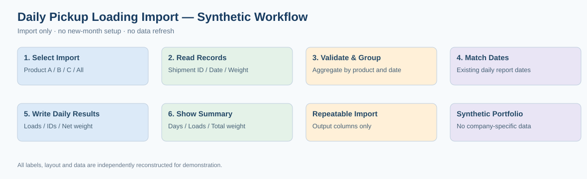

# Daily Pickup Loading Import — Synthetic VBA Portfolio

**Manufacturing Operations · Excel VBA · Shipment Aggregation · Data Validation**

This is an independently reconstructed, synthetic demonstration. It contains **no original employer code, screenshots, workbook structure, shipment identifiers, or real operating data**.

## Scope — Loading Import Only

The demo imports pickup/loading records for **Product A, B, or C individually, or all products together**. It deliberately **does not** initialize months, change reporting dates, refresh external data, or create reporting templates. Destination dates must already exist.

1. Read fictional pickup records with Shipment ID, Delivered Date, and Net Weight (LB).
2. Normalize Delivered Date to a calendar date (ignore time).
3. Group multiple loads on the same day for each product.
4. Match grouped records to the existing date column of the corresponding daily report.
5. Write daily **truck/load count**, **comma-and-space-separated Shipment IDs**, and **total net weight**.
6. Display a summary of **matched days, total loads, and total net weight** for each imported product.

## Workbook layout (entirely fictional)

Create six sheets: `Pickup_A`, `Pickup_B`, `Pickup_C`, `Daily_A`, `Daily_B`, `Daily_C`.

| Sheet | Column A | Column B | Column C | Column D |
|---|---|---|---|---|
| Pickup_A / B / C | Shipment ID | Delivered Date | Net Weight (LB) | — |
| Daily_A / B / C | Existing report date/time | Load count | Shipment IDs | Daily net weight (LB) |

Headers are on row 1. Daily reporting dates start at row 2 and must be prepared in advance. For example, `2026-01-04 17:00` matches `2026-01-04`.

## How to run

1. Create a **new, synthetic `.xlsm` workbook** with the six demo sheets above.
2. Use fictional records from `data/synthetic_pickups.csv` and reporting dates from `data/synthetic_daily_dates.csv`.
3. Import `src/PickupImport.bas` through the VBA editor.
4. Run `Import_A`, `Import_B`, `Import_C`, or `Import_All`.
5. Review the updated daily columns and completion message. Re-importing replaces only the three demo output columns, leaving the date column unchanged.

**No month creation or refresh macros are included.** A separate `src/demo.py` provides an optional synthetic-data test, not a claim of workplace Python usage.

## Expected synthetic sample

| Product | Matched days | Loads | Total weight (LB) |
|---|---:|---:|---:|
| A | 2 | 3 | 123,300 |
| B | 2 | 2 | 89,200 |
| C | 2 | 3 | 115,100 |

## Analyst contribution

- Standardize delivered dates and match source loads to existing reporting dates.
- Aggregate multiple loads per product and day, including shipment identifiers and net weights.
- Offer individual and consolidated import actions with completion summaries.
- Validate numeric weights and avoid overwriting reporting dates.

## Important limitations

Each valid source row counts as one load; this example does **not** deduplicate shipment IDs, independently verify shipment completion, or perform accounting reconciliation. Unmatched source dates are not written to the daily report. Errors are reported in the summary; do not use this demonstration for production accounting or shipping.

## Privacy

All names, schema, dates, identifiers, and weights are synthetic. Do not upload original employer workbooks, screenshots, or code. Check confidentiality and intellectual-property obligations before publishing.
